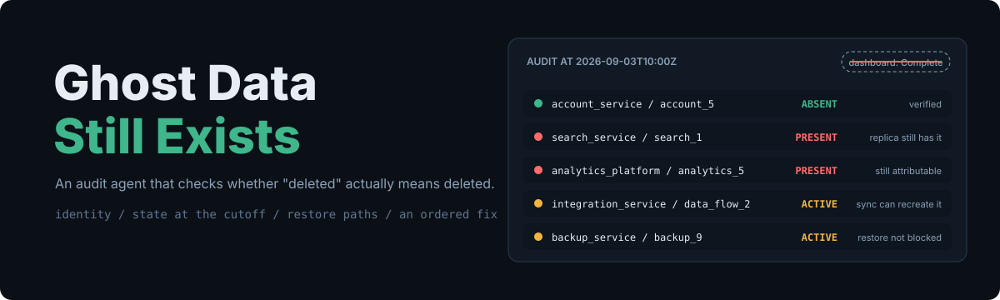
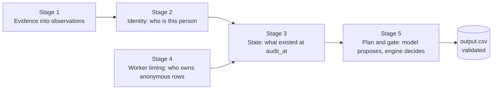
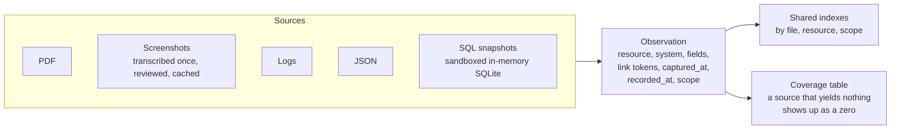
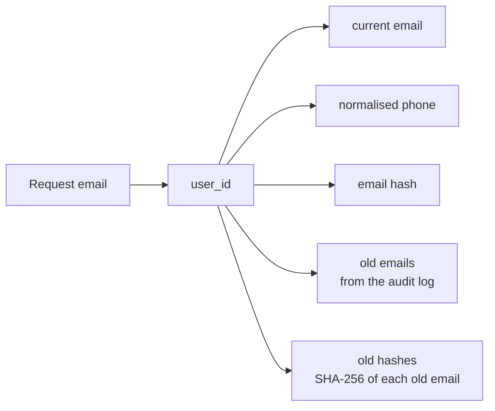
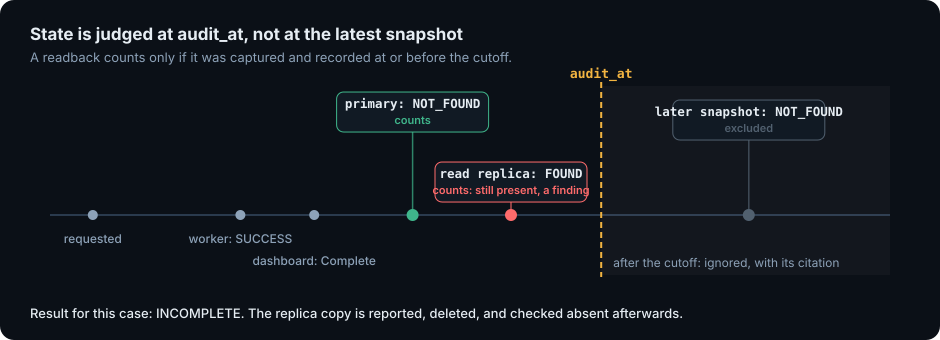
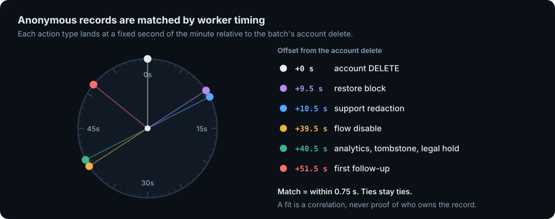
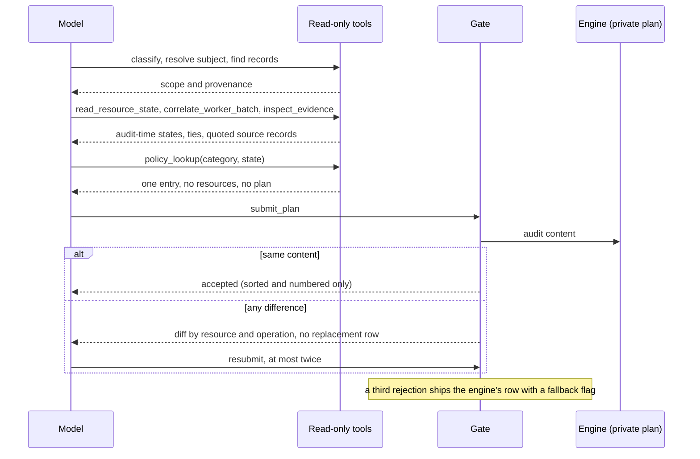

<div align="center">



**An audit agent that proves whether a person's data is really gone, finds what survived, and plans the fix.**

[](https://github.com/G26karthik/ghost-data-still-exists/actions/workflows/tests.yml)
[](requirements.txt)
[](LICENSE)
[](#the-result)

<br>


</div>

## The result

This project took **first place out of 4,650 participants** in HackerRank Orchestrate, October 2026. The certificate above is HackerRank's own. The agent was built for their challenge "Ghost Data Still Exists" and wrote all 518 answers on the evaluation set. I built it with OpenAI Codex as the coding agent.

The rank is HackerRank's and covers the whole submission. No hidden-set score was published, so none is quoted here.

> Northstar Shop's dashboards said the deletion was **Complete**. Weeks later the same customer tried to sign up again and was told the email was already registered. A sync job had rebuilt what the account service deleted, and copies still sat in support attachments, analytics exports, search indexes and backups.
>
> Northstar is the fictional company from the challenge. The failure mode is real.

This repository is that audit, in code. Many people have asked how it was approached, so the thinking is written down below, including what failed first.

##  What it returns

For each deletion request the agent works out who the person is (including old emails and hashes), reconstructs what every system held **at the audit cutoff**, and returns one verdict with an ordered plan.

| Verdict | Steps in the answer |
| --- | --- |
| `COMPLETE` | Verification steps that prove the current state, each citing the evidence behind it |
| `INCOMPLETE` | What still exposes the person, which sync or restore path can bring it back, the ordered fix, and the checks that must pass afterwards |
| `NOT_APPLICABLE` | `[]`. The person never asked for deletion, so nothing is authorised |

A workflow's own "Complete" is a claim, not evidence. So is a worker log that says `SUCCESS`.

##  How it works

A language model investigates through read-only tools and writes the plan itself. A deterministic engine audits it privately and a gate decides what gets through. Neither side is trusted alone: the model is better at reading messy evidence, the engine is better at being right the same way twice.



The five stages below each have one job and one module.

### 1. Evidence becomes observations <sub>`ghost/evidence.py`</sub>

Every file in the evidence manifest (PDFs, screenshots, logs, JSON, SQL snapshots) is parsed into the same small record: a resource, the system it lives in, its fields, the identifiers that link it to a person, when the source was captured and when the record was written. After that, nothing downstream cares what format the evidence came in.



Source text is treated as data. Tests cover an instruction hidden in screenshot text and a request that tries to change policy; neither changes a decision.

### 2. Identity is a set of tokens <sub>`ghost/identity.py`</sub>

A person is not one email address. The index holds current email, user ID, normalised phone and email hash, plus every old email and old hash recovered from the audit log, so a record that still carries yesterday's address resolves to the same person.



A user ID that merely appears near a subject proves nothing about ownership. A record is linked by an identifier it actually carries.

### 3. State is judged at the cutoff <sub>`ghost/state.py`</sub>

The question is never "does this record exist now?" It is "what did it look like at `audit_at`?" A readback counts only if it was both captured and recorded at or before the cutoff. A replica that still held the data then is a finding, even if a later snapshot looks clean, and a record recreated afterwards is excluded together with its citation.

<p align="center"></p>

Tombstones get special handling. Some systems keep an account stub so retained records can still point at the same `user_id`. The ID may stay. Name, email, phone and email hash may not, and a tombstone that still carries them is reported as exposed PII with a redaction step.

### 4. Anonymous records are matched by worker timing <sub>`ghost/activity.py`</sub>

Deleted accounts and anonymised analytics rows have no identity left, and the worker log names resources, not people. The one usable regularity is the worker itself: each action type lands at a fixed second of the minute relative to the batch's account delete.

<p align="center"></p>

Assignment runs across the whole request set, so one worker action cannot be claimed by two people. On 224 requests whose account delete is independently linked to the person, the 80-to-40-minute-before-report window held for all 224 and the follow-up timing for 148 of the 151 that could be checked. That is strong enough to rely on and not strong enough to call proof, so a tie is reported as `undetermined` instead of guessed.

A worker's operation is evidence about category, never about state. A logged `DELETE_RECORD` on a support target says the workflow treated it as an attachment, which has a different policy. Whether the record still exists comes from a readback.

### 5. The model proposes, the gate decides <sub>`ghost/agent.py`, `ghost/agent_tools.py`</sub>

The model gets eight read-only tools and never sees the engine's plan. `policy_lookup(category, state)` returns one policy entry and the operations it allows, with no resource IDs. The model combines that with the states and evidence IDs it read, then calls `submit_plan`.



The gate re-orders and re-numbers steps, which is all it will repair. A missing resource, an extra operation, a wrong status or a citation to the wrong file comes back as a diff. After the diff the model fixes its own plan, and a model that cites a resource it never read is rejected.

Final order follows the contract: findings, then remediation, then verification, and inside each phase by operation, then `system_id`, then `resource_id`. `ghost/validate.py` checks the finished CSV against the supplied files: header, case IDs, status and step consistency, numbering, `[]` for non-deletion, and that every citation exists and was captured at or before `audit_at`.

| Tool | Returns |
| --- | --- |
| `classify_request` | The guarded deletion decision and the original request text |
| `resolve_subject` | User ID and counts of identifier types, never raw identifiers |
| `find_linked_records` | Linked resources with category, source file and link basis |
| `correlate_worker_batch` | Assigned account delete, policy actions, candidates and unresolved ties |
| `read_resource_state` | Category, audit-time state, citation and basis |
| `inspect_evidence` | Up to 20 quoted source records, contrary ones included |
| `policy_lookup` | One policy entry for a category and state |
| `submit_plan` | The gate's verdict |

##  Measured results

Final run on all 518 evaluation requests (`gpt-6-luna`, low reasoning, eight workers).

| What | Result |
| --- | --- |
| Verdicts | **355** `INCOMPLETE`, **153** `COMPLETE`, **10** `NOT_APPLICABLE` |
| First decisions matching the engine's private plan | **503 / 518 (97.1%)** |
| Corrected by the model after a gate diff | 15 |
| Fallbacks to the engine | **0** |
| Plans visible to the model before it submitted | 0 |
| Fresh model calls / wall time | 5,190 / 1,181 s |
| Estimated cost | **USD 0.47** for the run, about USD 0.001 per request |
| Public samples: statuses / exact rows / steps | 32/32 / 29/32 / 190 of 193, none extra |
| Tests | 63 |

Read the agreement number for what it is: the model's first plan compared with the engine's private plan after sorting and numbering only. It shows the agent reaches the engine's answer through read-only tools without being shown it. It is not accuracy against the hidden answers, and the engine is not ground truth. The 32 public samples shaped development, so 29/32 is a fit and not a holdout. Twenty-nine evaluation requests have ownership links that rest on the timing tie-break.

The full-run token and cost breakdown: 13,734,621 input and 354,814 output tokens across 5,211 calls, USD 0.4747 including two probe runs. Those are estimates from saved receipts, not an invoice.

##  What failed first

The final design came after several wrong turns, and they are why it looks the way it does.

| Stage | Observation | What it taught |
| --- | --- | --- |
| Model-first investigator | 0/24 exact on exposed development rows, 15/24 statuses | The model was shown too little source evidence, and incomplete scope was suppressing actions it should have taken. |
| Stronger model, revised retrieval | Still 0/24 exact, 16/24 statuses | A bigger model did not fix a retrieval problem. The two paths differed in more than the model, so this compares architectures, not models. |
| Deterministic engine | 18/32 exact | Identity, time and policy are rules and belong in code. Anonymous ownership was still unlinked. |
| Worker-timing correlation | **29/32 exact**, 190/193 steps, none extra | Batch behaviour supplied the missing links. |
| Model back in, behind a gate | 503/518 first agreement, 0 fallbacks | A model reads evidence well; an engine applies rules the same way every time. |

Fixes that came out of looking at real failures:

- **Follow-up timing**, 97/142 became 148/151. The check ignored the candidate account's own replication checkpoint.
- **Support records.** Fifteen rows changed after a worker's `DELETE_RECORD` on a support target turned out to mean "attachment", not "gone". The plan now reports the remaining record and proposes delete plus an absence check.
- **A cache-miss log line** had been read as proof a record was absent. Six rows were corrected, and a genuine later 404 readback still counts.
- **A live repair worth keeping.** For a request with compliant readbacks and no findings, the model first proposed `INCOMPLETE` with empty verification citations. The gate named the wrong status and the three empty citations; the model resubmitted `COMPLETE` and cited the readback file.

Suspected fallbacks were removed one at a time. Two changed no rows and were deleted; a third changed one sample row, so it was kept, narrowed and renamed. Every changed row was traced to a source property, never to a case ID.

##  Bounded by design

None of this was profiled for peak memory, so there is no memory figure here. These are the limits that are in the code:

- **Parse once, share everywhere.** Evidence becomes observations once, and the indexes are built once and reused by all 518 cases.
- **One SQL snapshot at a time.** Each snapshot is loaded into an in-memory SQLite database, queried and closed. The connection denies `ATTACH`, `DETACH`, extension loading and every function except `json_valid`.
- **Bounded model context.** A tool returns at most 20 quoted records and clips fields at 500 characters. A case gets 24 tool calls (26 when ambiguous) and 2,600 output tokens.
- **Bounded spend.** A hard USD cap, a per-call timeout, a circuit breaker on provider failures and eight workers. SDK retries are off; the runtime owns retry behaviour.
- **Replayable.** Requests are keyed by hash and cached in append-only JSONL that tolerates a truncated last line, so a finished run replays byte for byte with no provider calls.
- **Fail closed on identity.** If a person could not be resolved, the runtime raises instead of planning a deletion for someone it could not name.

##  Try it

Python 3.11 or newer.

```bash
python -m venv .venv
source .venv/bin/activate        # Windows: .venv\Scripts\activate
pip install -r requirements.txt
python -m pytest
```

Five small synthetic cases ship in `evaluation/custom_cases/`: a replica that still holds data, a record created after the cutoff, a non-deletion request, a tombstone that still carries PII, and an anonymous analytics row found by worker timing. Run the engine on the tombstone case with no model and no network:

```bash
python main.py --offline --sample --dataset evaluation/custom_cases/tombstone_pii --run-dir runs/demo
cat runs/demo/sample_predictions.csv
```

```text
case_id,deletion_status,steps_json
tombstone_pii,INCOMPLETE,"[{""step_no"":1,""phase"":""FINDING"",""system_id"":""identity_service"",""resource_id"":""tombstone_4"",""operation"":""REPORT_EXPOSED_PII"",""state"":""PRESENT"",""evidence_id"":""evidence_01""},{""step_no"":2,""phase"":""REMEDIATION"",""system_id"":""identity_service"",""resource_id"":""tombstone_4"",""operation"":""REDACT_RECORD"",""state"":""REDACTED"",""evidence_id"":""""},{""step_no"":3,""phase"":""VERIFICATION"",""system_id"":""identity_service"",""resource_id"":""tombstone_4"",""operation"":""VERIFY_RECORD_REDACTED"",""state"":""REDACTED"",""evidence_id"":""""}]"
```

The only evidence is a JSON snapshot in which `tombstone_4` still holds the user's name and email. The finding cites it. The remediation and verification steps are proposals, so their citation is empty by contract. Score it against the expected answer:

```bash
python evaluation/main.py --dataset evaluation/custom_cases/tombstone_pii \
    --answers evaluation/custom_cases/tombstone_pii/sample_output.csv
```

### Running on the challenge data

The dataset belongs to HackerRank and is not redistributed here. Download it from the [official challenge repository](https://github.com/interviewstreet/hackerrank-orchestrate-october26) into `dataset/`, then:

```bash
export OPENAI_API_KEY=...         # PowerShell: $env:OPENAI_API_KEY = "..."
python main.py --run-dir runs/final                  # writes output.csv
python ghost/validate.py output.csv --dataset dataset
python main.py audit --case case_123 --explain       # one request, with its tool trace
python main.py serve --port 8080                     # POST {"case_id": "case_123"}
```

`GHOST_AGENT_MODEL`, `GHOST_AGENT_EFFORT`, `GHOST_AGENT_MAX_TOOLS`, `GHOST_AGENT_WORKERS`, `GHOST_AGENT_BUDGET_USD`, `GHOST_AGENT_TIMEOUT`, `GHOST_AGENT_MAX_OUTPUT` and `GHOST_AGENT_CACHE` tune the agent. Credentials come from the environment only.

## Tests

| Suite | Tests | Covers |
| --- | ---: | --- |
| `tests/test_ghost.py` | 14 | Identity, audit cutoff, worker timing offsets, replicas, tombstones, policy, request classification |
| `tests/test_submission.py` | 25 | Every source parser, the five synthetic cases, ordering, citation and numbering validation |
| `tests/test_agent.py` | 24 | The tool loop: clean path, gate diffs and repairs, hallucinated resources, future citations, injected source text, budget and circuit breaker, cache replay, the HTTP endpoint |

Three tests need the challenge dataset and skip without it. CI runs the rest on every push.

## How it was built

1. **The contract was the spec.** The grader is hidden, so the problem statement was the only description of what gets scored: status, identity resolution, discovered records and risks, cited evidence, policy decisions, and the completeness and order of steps. Each became something checkable locally. The code judge reads Markdown and ignores `.csv`, `.json` and `.log`, so every number in the evaluation reports lives in prose and tables.
2. **Measure the first idea.** The model-first investigator scored 0/24. That, not intuition, is what moved the rules into code.
3. **Samples are not a holdout.** The reports call 29/32 a fit. Agreement between model and engine is labelled as exactly that.
4. **Fix by source property, never by case ID.** Anything that changed an answer had to point at evidence.
5. **Report uncertainty where it lives.** The twenty-nine ownership links that rest on a tie-break were listed by ID in the submission's evaluation report rather than buried.
6. **Package like a stranger would unpack it.** The submission archive came from an explicit inclusion list: README, code, prompts, pinned dependencies and the two Markdown reports. It was extracted into an empty directory, installed from its declared dependencies only, run against the externally supplied dataset, and its regenerated CSV compared byte for byte with the frozen result. It was then scanned for credentials and for any command that depended on a file that was not shipped.

## Layout

```text
main.py                 batch run, single-case audit, HTTP endpoint
ghost/
  evidence.py           parsers: PDF, screenshots, logs, JSON, SQL snapshots
  identity.py           current and historical identifier index
  activity.py           worker-batch correlation and timing offsets
  state.py              resource state at the audit cutoff
  policy.py             category to required treatment
  planner.py            private plan and canonical ordering
  agent.py              tool loop, budget, cache, retries
  agent_tools.py        the eight read-only tools and the submission gate
  validate.py           contract check for the final CSV
  intake.py, vision.py  request classification and screenshot transcription
evaluation/             scoring script and five synthetic cases with expected answers
tests/
docs/assets/            README visuals
```

## Limitations

- A listed backup with no explicit restore block is treated as a restore risk. A block outside the supplied evidence would change that.
- When a legal hold's activity or a retention window is not stated in the record, it is inferred from the category and the plan notes the assumption.
- Timing identifies a candidate, not a person. The tie-break is named in the code (`activity.earliest_activity_tiebreak`) rather than hidden.
- 97% agreement with the engine says nothing about the hidden answers, and the 32 public samples shaped development.
- This is a batch runner with an HTTP wrapper, not a deployed service. In production it would need monitoring on source coverage, unresolved identity ties, rejected citations, cache misses and cost. The cheapest real improvement is a first-party batch ID or a per-resource subject key in the worker log, which would settle ties no model can.

## What isn't here

The challenge dataset, the reviewed model-response caches derived from it, the predictions file, run logs and session transcripts. Those either belong to HackerRank or contain material derived from their data. Without the caches, a full run needs the dataset and an API key instead of an offline replay.

## License

Source-available for reading and learning, not open source. Study it, run it locally, write about the ideas. Copying, modifying or reusing the code is not permitted: see [LICENSE](LICENSE). The techniques are yours to learn from; the implementation should be your own.

The challenge, its dataset and scoring are HackerRank's.
