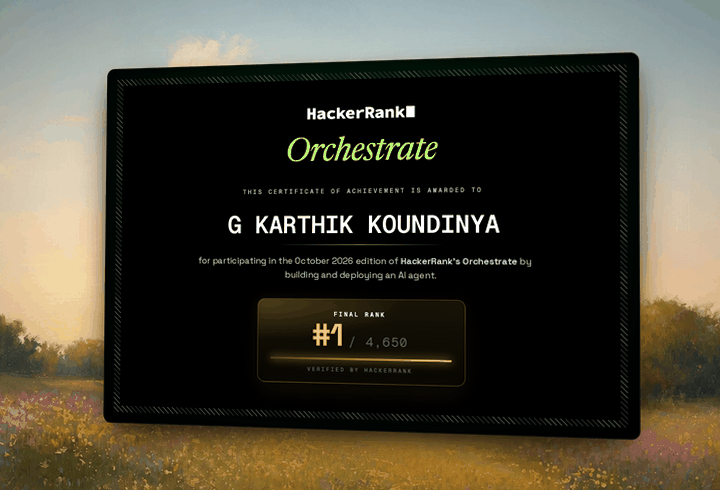
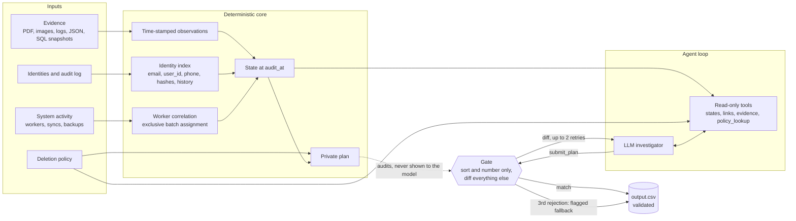

<div align="center">



# Ghost Data Still Exists

**An audit agent that checks whether "deleted" actually means deleted.**

Ranked **#1 of 4,650** in HackerRank Orchestrate, October 2026.

</div>

---

Northstar Shop's dashboards said the deletion was **Complete**. Weeks later the same customer tried to sign up again and was told the email was already registered. A sync job had quietly rebuilt what the account service had deleted, and copies were still sitting in support attachments, analytics exports, search indexes and backups.

(Northstar is the fictional company from the challenge. The failure mode is real.)

This agent does the audit nobody ran. For each deletion request it works out who the person is, including their old emails and hashes, reconstructs what every system held **at the audit cutoff**, and returns one of three verdicts with an ordered plan:

| Verdict | Output |
| --- | --- |
| `COMPLETE` | Verification steps that prove the current state, each citing the evidence it rests on |
| `INCOMPLETE` | What still exposes the person, which sync or restore path can bring it back, the ordered fix, and the checks that must pass afterwards |
| `NOT_APPLICABLE` | `[]`. The person never asked for deletion, so nothing is authorised |

A workflow's own "Complete" is treated as a claim, never as evidence. So is a worker log that says `SUCCESS`.

New here and wondering how this was approached? Read [docs/APPROACH.md](docs/APPROACH.md) first. It follows the thinking in order, including what failed.

## How it works

An LLM investigates through read-only tools and writes the plan itself. A deterministic gate decides what is allowed through. Neither is trusted alone: the model is better at reading messy evidence, the engine is better at being right the same way twice.



The model never sees the engine's answer. `policy_lookup(category, state_at_audit)` returns a single policy entry and the operations it allows, with no resources and no plan. The model combines that with the states and evidence IDs it read and calls `submit_plan`. The gate re-numbers and re-orders steps, which is all it fixes. If the content differs (a missing resource, an extra operation, a wrong status, a citation to the wrong file) it returns the difference and nothing else. After two failed resubmissions the case is flagged and falls back to the engine's row.

## Design decisions

**Audit-time state, not latest state.** A record that reappears after `audit_at` does not make an earlier deletion false, and a replica that still held the data at the cutoff does not stop mattering because a later snapshot is clean. A state readback has to be captured *and* recorded at or before the cutoff to count.

**Identity is a set of tokens, not an email match.** The index covers current email, user ID, normalised phone and email hash, plus every old email and old hash from the audit log. A user ID that merely appears near someone is not proof they own the record.

**Tombstones keep the ID and lose the person.** Some systems keep an account tombstone so retained records still resolve. The stable `user_id` may stay. Name, email, phone and email hash may not, and a tombstone that still carries them is reported as exposed PII with a redaction step.

**Anonymous records are linked by worker timing, and ties stay ties.** Deleted accounts and anonymised analytics rows carry no identity, so the only link is the deletion worker's batch behaviour. Assignment runs across the whole request set so one worker action cannot be claimed twice, uses measured offsets per policy action, and reports unresolved ties as ambiguity instead of guessing. That is a correlation, not an identity certificate, and the code says so wherever it uses it.

**A worker's operation is evidence about category, never about state.** A logged `DELETE_RECORD` on a support target tells you the workflow classified it as an attachment. Whether the record still exists comes from a readback.

**Evidence text is data.** Quoted records are clipped and passed to the model as untrusted content. Tests cover an instruction hidden inside screen text and a request that tries to change policy.

**Fail closed on identity.** An unresolved identity has no destructive fallback. The runtime raises instead of planning a deletion for someone it could not name.

**Bounded and replayable.** Eight workers, a hard USD budget cap, a per-call timeout, a provider circuit breaker, and a request-hash cache so a finished run replays byte for byte with zero provider calls.

More detail on each, with the module that owns it, is in [docs/ARCHITECTURE.md](docs/ARCHITECTURE.md). How the work was run, including audits, memory and resource limits, and packaging, is in [docs/APPROACH.md](docs/APPROACH.md).

## Results

Full 518-request run of the final configuration (`gpt-6-luna`, low reasoning, eight workers):

| | |
| --- | ---: |
| Requests audited | 518 |
| First decisions matching the engine's private plan | 503 / 518 (97.1%) |
| Accepted after a diff | 15 |
| Fallbacks to the engine | 0 |
| Verdicts | 355 `INCOMPLETE`, 153 `COMPLETE`, 10 `NOT_APPLICABLE` |
| Calls, fresh | 5,190 |
| Wall time | 1,181 s |
| Estimated cost | USD 0.47 for the run, USD 0.001 per request |
| Public samples: statuses / exact rows / steps | 32/32 / 29/32 / 190 of 193, none extra |
| Tests | 63 |

What these numbers mean, and don't. The 503/518 figure measures agreement between the model's plan and the engine's private plan after sorting and numbering only. It says the agent and the engine reach the same answer, not that either matches the hidden grader. The 32 public samples shaped development, so 29/32 is a fit, not a holdout. Twenty-nine evaluation requests have ownership links that are ambiguous, and their resolution rests on a documented timing tie-break. The rank is HackerRank's own and covers the whole submission. No hidden-set score was published, so none is stated here.

Failures and repairs are written up in [docs/RESULTS.md](docs/RESULTS.md), including a live case where the model proposed `INCOMPLETE` for a clean account, the gate named the wrong status and three empty citations, and the model corrected itself on the second submission.

## Try it

Python 3.11+.

```bash
python -m venv .venv
source .venv/bin/activate        # Windows: .venv\Scripts\activate
pip install -r requirements.txt
python -m pytest
```

The repo ships five small synthetic cases in `evaluation/custom_cases/`: a replica that still holds data, a record created after the cutoff, a non-deletion request, a tombstone that still carries PII, and an anonymous analytics row found by worker timing. Run the engine on the tombstone case, with no model and no network:

```bash
python main.py --offline --sample --dataset evaluation/custom_cases/tombstone_pii --run-dir runs/demo
cat runs/demo/sample_predictions.csv
```

```text
case_id,deletion_status,steps_json
tombstone_pii,INCOMPLETE,"[{""step_no"":1,""phase"":""FINDING"",""system_id"":""identity_service"",""resource_id"":""tombstone_4"",""operation"":""REPORT_EXPOSED_PII"",""state"":""PRESENT"",""evidence_id"":""evidence_01""},{""step_no"":2,""phase"":""REMEDIATION"",""system_id"":""identity_service"",""resource_id"":""tombstone_4"",""operation"":""REDACT_RECORD"",""state"":""REDACTED"",""evidence_id"":""""},{""step_no"":3,""phase"":""VERIFICATION"",""system_id"":""identity_service"",""resource_id"":""tombstone_4"",""operation"":""VERIFY_RECORD_REDACTED"",""state"":""REDACTED"",""evidence_id"":""""}]"
```

The evidence for that case is one JSON snapshot in which `tombstone_4` still holds the user's name and email. The finding cites the snapshot; the remediation and verification steps are proposals, so their citation is empty by contract. Score it against the expected answer:

```bash
python evaluation/main.py --dataset evaluation/custom_cases/tombstone_pii \
    --answers evaluation/custom_cases/tombstone_pii/sample_output.csv
```

## Running on the challenge data

The dataset belongs to HackerRank and is not redistributed here. Download it from the [official challenge repository](https://github.com/interviewstreet/hackerrank-orchestrate-october26) into `dataset/`, then:

```bash
export OPENAI_API_KEY=...         # PowerShell: $env:OPENAI_API_KEY = "..."
python main.py --run-dir runs/final       # writes output.csv
python ghost/validate.py output.csv --dataset dataset
python main.py audit --case case_123      # one request, with its tool trace
python main.py serve --port 8080          # POST {"case_id": "case_123"}
```

`GHOST_AGENT_MODEL`, `GHOST_AGENT_EFFORT`, `GHOST_AGENT_MAX_TOOLS`, `GHOST_AGENT_WORKERS`, `GHOST_AGENT_BUDGET_USD`, `GHOST_AGENT_TIMEOUT`, `GHOST_AGENT_MAX_OUTPUT` and `GHOST_AGENT_CACHE` tune the agent. Defaults are 24 tool calls per case, eight workers, a 120 s timeout and a USD 3 cap. Credentials are read from the environment only.

## Layout

```text
main.py                 entry point: batch run, single-case audit, HTTP endpoint
ghost/
  evidence.py           PDF, image, log, JSON and SQL-snapshot parsers -> observations
  identity.py           current and historical identifier index
  activity.py           worker-batch correlation and timing offsets
  state.py              resource state at the audit cutoff
  policy.py             category -> required treatment
  planner.py            private plan and canonical ordering
  agent.py              Responses loop, budget, cache, retries
  agent_tools.py        the eight read-only tools and the submission gate
  validate.py           contract check for the final CSV
  intake.py, vision.py  request classification and screenshot transcription
evaluation/
  main.py               case, step, field and sequence scoring
  custom_cases/         five synthetic scenarios with expected answers
tests/                  63 tests; three need the challenge dataset and skip without it
docs/                   architecture and results
```

## What isn't here

The challenge dataset, the reviewed model-response caches derived from it, the predictions file, run logs and session transcripts. Those either belong to HackerRank or contain material derived from their data. The source, tests and synthetic cases are the whole system; without the caches, a full run needs the dataset and an API key rather than an offline replay.

## License

Source-available for reading and learning, not open source. You are welcome to study it, run it locally and write about the ideas. Copying, modifying or reusing the code is not permitted. See [LICENSE](LICENSE). The techniques are yours to learn from; the implementation should be your own.

## Credits

Built for [HackerRank Orchestrate](https://www.hackerrank.com/) (October 2026) with OpenAI Codex as the coding agent. The challenge, dataset and scoring are HackerRank's.
